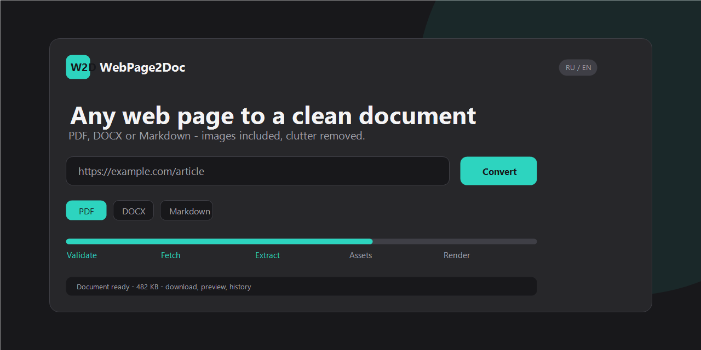

<div align="center">

# 📄 WebPage2Doc

**Any web page → a clean PDF, DOCX or Markdown. Right in your browser, no servers.**

[Русский](README.md) · [Architecture](docs/ARCHITECTURE.md) · [Decisions](docs/DECISIONS.md)

[](https://developer.chrome.com/docs/extensions/)
[](https://developer.chrome.com/docs/extensions/develop/concepts/manifest)
[](https://react.dev/)
[](https://www.typescriptlang.org/)
[](LICENSE)
[](https://github.com/evangreen165/webpage2doc/releases)



</div>

> Open a page → click the icon → pick a format → get a ZIP with the document and its images. Everything runs locally in your browser; nothing is sent to any server.

## ✨ Features

| | Feature | What it does |
|---|---|---|
| 📄 | **Three formats** | PDF, DOCX and Markdown from the current tab |
| 🖼 | **Images** | ``, `data-src`, `srcset`, CSS `background-image` → `images/` folder in the ZIP, embedded in PDF/DOCX |
| 🎬 | **Video** | `<video>` and `<iframe>` become a `[Видео: url]` link, nothing is downloaded |
| 🧹 | **Clean text** | navbars, banners, footers and other boilerplate are stripped |
| 📦 | **ZIP archive** | document + `images/` folder packed into a single file |
| ⚡ | **Staged progress** | collect → extract → images → render → pack |
| 🕘 | **History** | last 10 generations in `localStorage` |
| 🌗 | **Dark theme** | light and dark, remembered |
| 🌐 | **RU / EN** | one-click language switch |
| 🔒 | **No servers** | the page and your data never leave your computer |

<details>
<summary><b>Limits and caveats</b></summary>

- At most **200** images and **100 MB** total per generation.
- PDF should stay under ~**50 pages**; a warning is issued beyond that.
- Hotlink-protected or login-only images are skipped and replaced by alt text with a warning.
- Login-only, captcha-protected and infinite-scroll pages are saved partially with a warning.
- `chrome://`, Web Store and other system tabs are not supported.
- Keep the side panel open during generation; closing it aborts the task.
</details>

## 🚀 Installation (Load unpacked)

### Option A: from source

```bash
git clone https://github.com/evangreen165/webpage2doc.git
cd webpage2doc
npm ci
npm run build        # produces dist/
```

### Option B: from Release

1. Download `webpage2doc-<version>.zip` from [Releases](https://github.com/evangreen165/webpage2doc/releases).
2. Unzip it into a dedicated folder.

### Load the extension

1. Open `chrome://extensions`.
2. Enable **Developer mode** (toggle, top right).
3. Click **Load unpacked**.
4. Select the `dist/` folder (or the unzipped Release).
5. Pin the WebPage2Doc icon to the toolbar.

## 🖱 Usage

1. Open any article in the current tab.
2. Click the WebPage2Doc icon — the side panel opens.
3. Pick a format: **PDF**, **DOCX** or **Markdown** (and "download images").
4. Click **"Generate document"**.
5. A ZIP downloads: the document plus an `images/` folder.

> The "read and change all your data on websites" permission is required to download images and process any page. Data never leaves your machine.

## 🏗 Architecture

```
[Tab] ──content script──▶ [Side Panel: React]
                              │  fetch images (CORS bypassed via host_permissions)
                              │  render: PDF (html2pdf.js) / DOCX (docx) / MD (turndown)
                              │  jszip → document + images/
                              └─▶ chrome.downloads.download(ZIP)
```

See [docs/ARCHITECTURE.md](docs/ARCHITECTURE.md) and [docs/DECISIONS.md](docs/DECISIONS.md).

## 🧪 Development

```bash
npm ci
npm run lint         # eslint
npx tsc --noEmit     # type check
npm run build        # build dist/
```

Release ZIP: `npm run build && node scripts/zip-release.mjs`.

## 🗺 Roadmap

- [x] MVP: PDF / DOCX / Markdown, images, video links, ZIP
- [x] Side Panel, progress, history, RU/EN, dark theme
- [x] Tag-driven CI and releases (ZIP)
- [ ] Chrome Web Store publication
- [ ] Batch processing of multiple tabs
- [ ] EPUB export

## 📄 Licenses

| Component | License |
|---|---|
| WebPage2Doc | **MIT** |
| React, Vite, TypeScript, Tailwind | MIT / Apache-2.0 |
| @mozilla/readability | MPL-2.0 (file-level, MIT-compatible) |
| html2pdf.js / jsPDF / html2canvas | MIT |
| docx, jszip, turndown | MIT |

Full text: [LICENSE](LICENSE).

---

<div align="center">

Machine-readable summary: [`llms.txt`](llms.txt)

Built for people who want to keep the article, not the tab.

</div>
