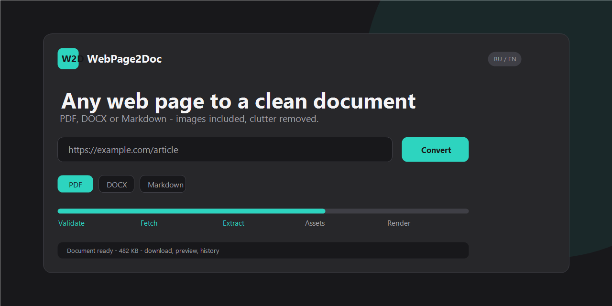

<div align="center">

# 📄 WebPage2Doc

**Любая веб-страница → аккуратный PDF, DOCX или Markdown. Прямо в браузере, без серверов.**

[English](README.en.md) · [Архитектура](docs/ARCHITECTURE.md) · [Решения](docs/DECISIONS.md)

[](https://developer.chrome.com/docs/extensions/)
[](https://developer.chrome.com/docs/extensions/develop/concepts/manifest)
[](https://react.dev/)
[](https://www.typescriptlang.org/)
[](LICENSE)
[](https://github.com/evangreen165/webpage2doc/releases)



</div>

> Откройте страницу → нажмите на иконку → выберите формат → получите ZIP с документом и картинками. Всё работает локально в вашем браузере, ничего не отправляется на серверы.

## ✨ Возможности

| | Возможность | Что делает |
|---|---|---|
| 📄 | **Три формата** | PDF, DOCX и Markdown из текущей вкладки |
| 🖼 | **Изображения** | ``, `data-src`, `srcset`, CSS `background-image` → папка `images/` в ZIP, в PDF/DOCX — встроенные |
| 🎬 | **Видео** | `<video>` и `<iframe>` превращаются в ссылку `[Видео: url]`, ничего не скачивается |
| 🧹 | **Чистый текст** | убираются меню, баннеры, футеры и прочий boilerplate |
| 📦 | **ZIP-архив** | документ и папка `images/` упаковываются в один файл |
| ⚡ | **Прогресс по этапам** | сбор → извлечение → картинки → рендер → упаковка |
| 🕘 | **История** | последние 10 генераций в `localStorage` |
| 🌗 | **Тёмная тема** | и светлая; выбор запоминается |
| 🌐 | **RU / EN** | переключение языка в один клик |
| 🔒 | **Без серверов** | страница и данные не покидают ваш компьютер |

<details>
<summary><b>Лимиты и ограничения</b></summary>

- Изображений — не более **200**, общий объём — до **100 МБ** на генерацию.
- PDF не должен превышать ~**50 страниц** — при переполнении выдаётся предупреждение.
- Картинки, которые сайт защищает (hotlink-защита, авторизация), не скачаются — в документе останется alt-текст и предупреждение.
- Страницы с логином, капчей или бесконечной прокруткой сохраняются частично — с предупреждением.
- Вкладки `chrome://`, Web Store и другие системные страницы не поддерживаются.
- Во время генерации не закрывайте панель — задача прервётся.
</details>

## 🚀 Установка (Load unpacked)

### Вариант A: из исходников

```bash
git clone https://github.com/evangreen165/webpage2doc.git
cd webpage2doc
npm ci
npm run build        # создаёт папку dist/
```

### Вариант B: из Release

1. Скачайте `webpage2doc-<версия>.zip` со страницы [Releases](https://github.com/evangreen165/webpage2doc/releases).
2. Распакуйте в отдельную папку.

### Подключение расширения

1. Откройте `chrome://extensions`.
2. Включите **Developer mode** (переключатель справа сверху).
3. Нажмите **Load unpacked** («Загрузить распакованное расширение»).
4. Выберите папку `dist/` (или распакованную из Release).
5. Закрепите иконку WebPage2Doc на панели инструментов.

## 🖱 Использование

1. Откройте любую статью в текущей вкладке.
2. Нажмите на иконку WebPage2Doc — откроется боковая панель.
3. Выберите формат: **PDF**, **DOCX** или **Markdown** (и «скачивать картинки»).
4. Нажмите **«Сгенерировать документ»**.
5. Скачается ZIP: внутри документ и папка `images/`.

> Разрешение «чтение и изменение всех данных на сайтах» нужно, чтобы плагин мог скачать картинки и обработать любую страницу. Данные никуда не отправляются.

## 🏗 Архитектура

```
[Вкладка] ──content script──▶ [Side Panel: React]
                                  │  fetch картинок (CORS обходит host_permissions)
                                  │  рендер: PDF (html2pdf.js) / DOCX (docx) / MD (turndown)
                                  │  jszip → document + images/
                                  └─▶ chrome.downloads.download(ZIP)
```

Подробно: [docs/ARCHITECTURE.md](docs/ARCHITECTURE.md) · решения: [docs/DECISIONS.md](docs/DECISIONS.md).

## 🧪 Разработка

```bash
npm ci
npm run lint         # eslint
npx tsc --noEmit     # проверка типов
npm run build        # сборка dist/
```

Релизный ZIP: `npm run build && node scripts/zip-release.mjs`.

## 🗺 Roadmap

- [x] MVP: PDF / DOCX / Markdown, картинки, ссылки на видео, ZIP
- [x] Side Panel, прогресс, история, RU/EN, тёмная тема
- [x] CI и релизы по тегам (ZIP)
- [ ] Публикация в Chrome Web Store
- [ ] Массовая обработка нескольких вкладок
- [ ] EPUB-экспорт

## 📄 Лицензии

| Компонент | Лицензия |
|---|---|
| WebPage2Doc | **MIT** |
| React, Vite, TypeScript, Tailwind | MIT / Apache-2.0 |
| @mozilla/readability | MPL-2.0 (файловая, совместима с MIT) |
| html2pdf.js / jsPDF / html2canvas | MIT |
| docx, jszip, turndown | MIT |

Полный текст лицензии проекта — [LICENSE](LICENSE).

---

<div align="center">

Машинно-читаемое описание: [`llms.txt`](llms.txt)

Сделано для тех, кто хочет сохранить статью, а не вкладку.

</div>
